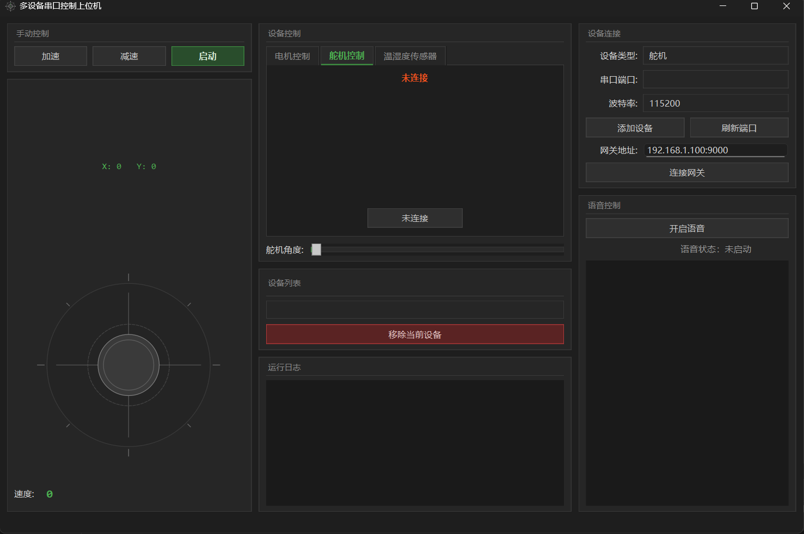

# mawinHcom — 多设备串口控制上位机

基于 Qt 6 的工业风格上位机，通过串口对电机 / 舵机 / 温湿度传感器等多类型设备统一管理，支持图形摇杆与离线语音两种控制方式。

## 功能

- **多设备串口管理**：设备类型选择、串口/波特率配置、设备添加与移除，每个设备独立线程隔离，互不阻塞
- **图形摇杆控制**：自定义 QPainter 绘制的工业风摇杆，实时 X/Y 坐标显示（-100 ~ +100），拖拽直接下发控制帧
- **离线语音控制**：集成 Vosk 中文语音识别，"加速 / 减速 / 向左 / 向右"语音指令驱动摇杆，无需联网
- **设备控制面板**：电机启停与速度调节、舵机角度滑条、温湿度传感器定时读取，各面板独立连接状态
- **全链路日志**：设备连接、指令下发、数据接收、串口错误全部落盘（`mawinHcom.log`）并同步显示到界面

## 通信协议

串口帧格式（自定义二进制协议）：

```
AA + cmdType + deviceType + dataLen + data + checksum + 55
```

- 设备类型：电机(0x01) / 舵机(0x02) / 传感器(0x03)
- 命令类型：控制(0x01) / 电机速度(0x02) / 舵机角度(0x04) / 传感器读取(0x05) / 紧急停止(0x06)
- 接收侧状态机逐字节扫描帧头，校验和 + 帧尾双重校验，错误传播限制在一帧以内

## 下位机

STM32F103 解析控制帧并驱动外设：舵机（0~180° 角度指令）、电机（速度指令）、温湿度传感器（定时上报）。串口参数 115200, 8N1。

## 架构

```
UI 主线程(QMainWindow/QML风格QSS)
   │  Qt::QueuedConnection 跨线程信号
   ├── DeviceManager ── 每设备独立 QThread(SerialWork)
   │                       └── RingBuffer 线程安全缓冲
   ├── VoskWorker(QThread) ── 语音识别线程
   └── Logger 单例 ── 文件 + 界面双写
```

- 串口收发在设备线程内完成，UI 永不阻塞
- RingBuffer 的 count 使用原子变量，避免读写竞态

## 界面截图

<!-- TODO: 截图放 docs/ 目录 -->


## 构建

环境：Qt 6.3（MinGW）+ CMake。

Vosk 库与语音模型体积较大，不在仓库中：从 [Releases](../../releases) 下载完整包（已含全部依赖），或自行下载 [Vosk](https://github.com/alphacep/vosk-api) 库（vosk-win64-0.3.45）放入 `libs/`、中文小模型（vosk-model-small-cn-0.22）放入 `model/`。

```
cmake -S . -B build -G "MinGW Makefiles" -DCMAKE_PREFIX_PATH=<Qt路径>
cmake --build build -j
```

## 运行

从 [Releases](../../releases) 下载 `VoiceJoystick-v1.0-win64.zip`，解压后直接运行 `mawinHcom.exe`——Qt 运行时、Vosk 模型、ffmpeg 依赖全部内置，无需安装任何环境。

语音控制需要麦克风；无串口硬件时界面可正常浏览，连接功能需接入 STM32 下位机。
